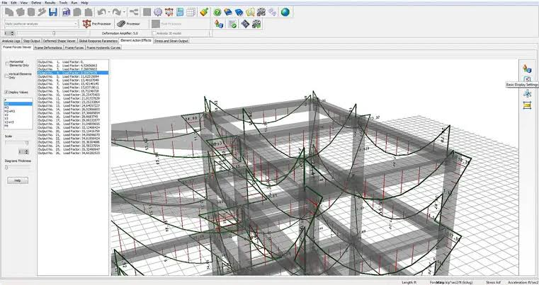
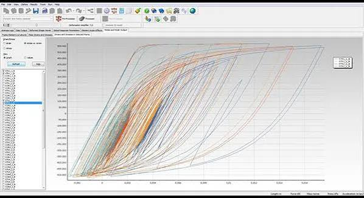
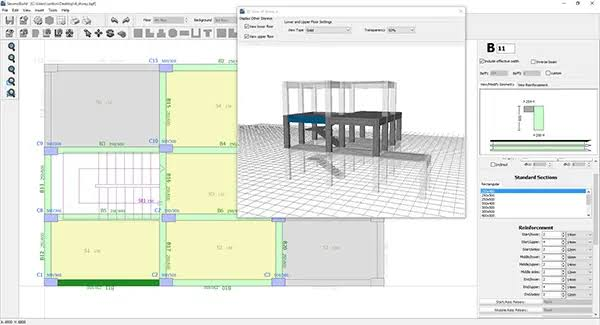

# SeismoStruct Guides Nonlinear Analysis of Framed Structures

SeismoStruct Software models framed structures with material inelasticity and geometric nonlinearity.
Choose the analysis around the response you need to understand, then retain the assumptions and numerical evidence that support its interpretation.

## Decide which response the analysis should reveal

A SeismoStruct Tutorial is most useful when it connects a modelling decision to an observable result.
Begin with a clearly stated question instead of selecting a procedure only because it produces a familiar plot.

| Question | Procedure to consider | What changes during the run | Result to inspect |
| --- | --- | --- | --- |
| What are the vibration characteristics? | Eigenvalue analysis | Mode under examination | Periods and mode shapes |
| How does lateral capacity develop? | Static pushover | Applied loading or controlled response | Capacity curve and deformation pattern |
| How does response evolve under a record? | Dynamic time-history | Time and imposed excitation | Response histories and their peaks |
| How does response vary with record intensity? | Incremental dynamic analysis | Ground-motion intensity between runs | Intensity-dependent response and run status |

The [analysis-type reference](https://help.seismosoft.com/seismostruct/2026/en/analysis_types/) describes the available procedures and their different model requirements.
When changing analysis type, review the resulting mass, damping, and loading definitions.
A model prepared for one procedure may need explicit changes before it answers another question.

[](https://seismostruct-tutorial.github.io/SeismoStruct-Software/)

## Build confidence in the model one mechanism at a time

### Geometry, restraints, and the elastic baseline

Check node coordinates, member orientation, restraints, releases, and the intended load path.
Compare an elastic response with an independently understood case before introducing additional nonlinear mechanisms.
Use the [units selector documentation](https://help.seismosoft.com/seismostruct/2026/en/using_the_pre-processor/units_selector.htm) to keep length, force, and derived quantities consistent.

The reference [test_force-beam-column.py](tests/test_force-beam-column.py) compares cantilever response with elastic formulae.
The checks in [test_mod_elastic_beam_loads.py](tests/test_mod_elastic_beam_loads.py) address equilibrium and fixed-end effects under member loading.
The plane-stress example [test_tri31-strain.py](tests/test_tri31-strain.py) illustrates a constant-strain verification case.
Use a benchmark whose assumptions match the mechanism under review.

### Sections, materials, and cyclic response

For seismostruct finite element software studies, connect each constitutive choice to the expected response.
Distinguish section discretization, member formulation, and material parameters when changing the model.
Review the [SeismoStruct product description](https://seismosoft.com/products/seismostruct/) for the supported modelling families.

The viewer support file [uniaxialMaterials.tcl](SCRIPTS/uniaxialMaterials.tcl) defines sample material-menu entries.
The companion [strain.tcl](SCRIPTS/strain.tcl) provides a uniaxial material-viewer interface.
The regression [test_hystereticsm_reconnection.py](tests/test_hystereticsm_reconnection.py) examines reconnection behavior within a cyclic response.



Parameter sensitivity provides a different check from agreement at a single load level.
The tests [test_concrete02_sensitivity.py](tests/test_concrete02_sensitivity.py) and [test_concrete02is_sensitivity.py](tests/test_concrete02is_sensitivity.py) compare response derivatives with finite differences.
Their model names and sign conventions belong to their documented implementations.

## Use targeted cyclic probes before a larger study

A seismostruct nonlinear analysis may depend strongly on unloading, reloading, and hardening assumptions.
Inspect those mechanisms with a controlled history before relying on the response of an entire building.
Changing several parameters together can conceal which assumption caused the difference.

The following supplied probes isolate different Steel01 hardening parameters:

- [steel01_ddm_a1_probe.tcl](tests/steel01_ddm_a1_probe.tcl) focuses on a1 sensitivity.
- [steel01_ddm_a2_probe.tcl](tests/steel01_ddm_a2_probe.tcl) focuses on a2 sensitivity.
- [steel01_ddm_a3_probe.tcl](tests/steel01_ddm_a3_probe.tcl) focuses on a3 sensitivity.
- [steel01_ddm_a4_probe.tcl](tests/steel01_ddm_a4_probe.tcl) focuses on a4 sensitivity.

The broader [steel01_ddm_isotropic_check.tcl](tests/steel01_ddm_isotropic_check.tcl) compares direct sensitivities with finite differences through several cyclic histories.
With the OpenSees Tcl executable available on PATH, run that verification from the repository root:

```powershell
OpenSees "tests/steel01_ddm_isotropic_check.tcl"
```

The [OpenSees modelling guide](https://opensees.berkeley.edu/wiki/index.php/Getting_Started) introduces Tcl-based model and analysis commands.
This test reports failures through its messages and exit status.
Use its parameters to understand the benchmark, rather than adopting them as material values for another structure.

## Keep gravity, mass, and excitation consistent

Establish the intended initial state before applying the earthquake record.
Check the relationship between gravity loading and mass assignment, including any element or nodal contributions.
Keep the excitation direction, acceleration units, time increment, and record scaling identifiable.

The reference [test_elastic_beam_ground_motion.py](tests/test_elastic_beam_ground_motion.py) checks inertia loading with element mass.
The cases in [test_ground_motion_derivation.py](tests/test_ground_motion_derivation.py) examine prescribed motion and relationships between motion components.
The staged test [test_sensitivity_after_loadconst.py](tests/test_sensitivity_after_loadconst.py) checks sensitivity after gravity loads are held constant.

For time-history interpretation, compare response channels at matching times and with the same reference convention.
Confirm whether reported motion is relative or absolute before comparing it with another program.
Document the damping model and the state from which the dynamic analysis begins.



## Investigate the last reliable equilibrium state

A stopped analysis needs a recorded reason and an identifiable last completed step.
Inspect the model and loading before changing numerical controls.
SeismoStruct's [nonlinear solution procedure](https://help.seismosoft.com/seismostruct/2026/en/theoretical_background_and_modelling_assumptions/nonlinear_solution_procedure/) uses incremental iterative equilibrium solutions.

Its [convergence criteria](https://help.seismosoft.com/seismostruct/2026/en/theoretical_background_and_modelling_assumptions/nonlinear_solution_procedure/convergence_criteria.htm) distinguish displacement/rotation and force/moment checks.
Record the selected scheme and tolerances with the results.
A change that permits completion should be evaluated for its effect on the response, not judged only by the final run status.

The regression [test_bandgen_solver.py](tests/test_bandgen_solver.py) includes nonfinite-system checks for a banded solver.
The test definition [CMakeLists.txt](tests/CMakeLists.txt) registers a separate matrix/vector executable.
The guide [README.md](tests/README.md) explains the Python verification-test environment.
These references illustrate numerical verification at different levels of a solver.

## Extract results that answer the original question

Use SeismoBatch to organize repeated analyses and extract selected result channels.
The [batch-facility documentation](https://help.seismosoft.com/seismostruct/2026/en/processor_and_post-processor/batch_facility.htm?agt=index) describes project selection and column-based text output.
Keep each run's input identity, completion status, and response channels together when comparing cases.

For an independent drift calculation, prepare a CSV with columns case, step, u_top_mm, u_base_mm, and height_mm.
Each row must contain synchronized horizontal displacements for one storey and a positive storey height.
This is a review-table convention, not a claimed native SeismoStruct export schema.

```python
import csv

with open("storey-response.csv", newline="", encoding="utf-8") as source:
    for row in csv.DictReader(source):
        height = float(row["height_mm"])
        if height <= 0:
            raise ValueError("Storey height must be positive")
        drift = (float(row["u_top_mm"]) - float(row["u_base_mm"])) / height
        print(row["case"], row["step"], f"{drift:.6g}")
```

Python's [CSV reference](https://docs.python.org/3/library/csv.html) documents the named-column reader.
The output is a signed displacement-to-height ratio; any acceptance criterion must be defined separately for the assessment.
Retain the source histories so a peak can be traced to its case and step.



When reviewing seismostruct examples exchanged with another solver, compare definitions as well as output values.
The helper [toOpenSeesPy.py](SCRIPTS/toOpenSeesPy.py) converts simple line-oriented OpenSees Tcl commands to Python.
Its documented limitations exclude general conversion of Tcl loops, variables, and expressions.

## Related Search Terms

SeismoStruct Tutorial, SeismoStruct Software, seismostruct examples, seismostruct finite element software, seismostruct nonlinear analysis, structural-analysis, structural-engineering, finite-element-analysis, earthquake-engineering, nonlinear-analysis, seismic-assessment, reinforced-concrete, pushover-analysis, time-history-analysis, python
